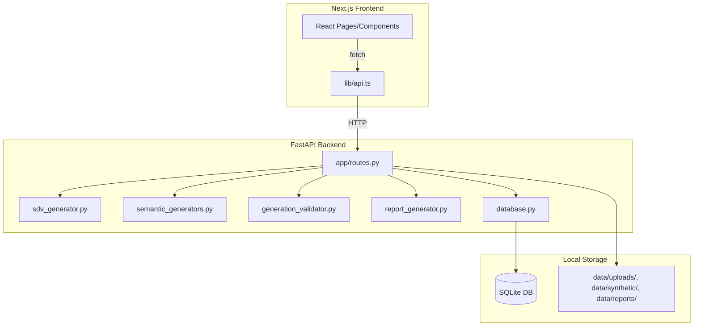

# DataNova — Synthetic Data Studio

**DataNova** is a full-stack web application that generates **synthetic datasets** — realistic, statistically faithful fake data that behaves like real data without exposing anyone's actual records. It was built by **Nuha Khan**.

You give DataNova either an **existing CSV file** or a **plain-English description** of the dataset you want, and it produces a new synthetic dataset, measures how good that dataset is, lets you save the whole workflow as a project, and exports a **PDF evaluation report**.

## Why synthetic data?

Real data is often **sensitive** (customer records, medical info, employee lists) or **too small** to train and test software on. Manually inventing thousands of realistic rows is slow and produces obviously fake values (every age is 25, every name is "John Doe", phone numbers are `12345`).

DataNova solves this by:

- **Preserving structure and relationships** — correlations, distributions, and category frequencies from your real data carry over to the synthetic data.
- **Generating realistic values** — names, emails, phone numbers, addresses, and dates follow real-world formats and are internally consistent (date of birth matches age; a person's city and state agree; hire date comes after date of birth).
- **Working locally** — no account, no sign-up, no external AI service. Everything runs on your machine and stays there.
- **Being honest about quality** — every generated dataset is validated and scored with real statistical measures, not marketing claims.

---

## Table of Contents

1. [Project Overview](#1-project-overview)
2. [Features](#2-features)
3. [Complete Technology Stack](#3-complete-technology-stack)
4. [Is DataNova an ML Model, AI Model, or Rule-Based System?](#4-is-datanova-an-ml-model-ai-model-or-rule-based-system)
5. [Frontend Architecture](#5-frontend-architecture)
6. [Backend Architecture](#6-backend-architecture)
7. [End-to-End Workflows](#7-end-to-end-workflows)
8. [API Documentation](#8-api-documentation)
9. [Database and Storage](#9-database-and-storage)
10. [Local Setup and Execution (Windows)](#10-local-setup-and-execution-windows)
11. [Environment Variables and Secrets](#11-environment-variables-and-secrets)
12. [Limitations, Risks, and Future Improvements](#12-limitations-risks-and-future-improvements)
13. [Troubleshooting](#13-troubleshooting)
14. [Deployment and Maintenance](#14-deployment-and-maintenance)
15. [Project Owner Quick Reference](#15-project-owner-quick-reference)

---

## 1. Project Overview

### What DataNova is

DataNova is a **local-first Synthetic Data Studio**: a web application that runs entirely on your computer. It has two halves — a Python backend that does the heavy data work and a Next.js frontend you interact with in a browser.

### The problem it solves

Organizations need data to build, test, and demo software, but sharing real customer/employee/patient data is risky (privacy laws, compliance, embarrassment). Data scientists also frequently need **more data** than they have — a 200-row dataset is too small to train a model on or to test an application against.

DataNova produces synthetic datasets that:

- **Look and behave like the real thing** — same columns, same data types, same statistical patterns.
- **Contain no real personal records** — every row is machine-generated.
- **Can be generated in seconds** — instead of hours of manual data entry.

### Who can use it

- **Students and educators** — learn about data synthesis, ML evaluation, and privacy without needing real data.
- **Software developers** — generate realistic test/demo data for applications.
- **Data analysts/scientists** — augment small datasets, test pipelines, or share examples safely.
- **Anyone** who needs realistic mock data quickly.

### Main features (summary)

- **Mode A — Expand an existing dataset**: upload a CSV, get a health check, generate additional synthetic rows using SDV (GaussianCopula, CTGAN, or TVAE).
- **Mode B — Generate from requirements**: describe the dataset you want in plain English ("generate 500 employee records for an Indian company with name, age, salary, and city"), and DataNova builds it.
- **Evaluation**: statistical comparison (KS/TVD similarity, association matrices, target comparison), an ML utility experiment (train on real vs. train on synthetic), and rule-based explanations.
- **Projects**: save, list, rename, and revisit completed workflows.
- **PDF reports**: export a branded 10-section evaluation report.
- **Messy data**: deliberately introduce realistic data-quality problems (missing values, duplicates, whitespace, outliers) into any dataset.

### Inputs and outputs

| | |
|---|---|
| **Inputs** | A CSV file (max 50 MB), or a plain-English text description |
| **Outputs** | Synthetic CSV download, PDF evaluation report, saved project history |

---

## 2. Features

All features below are **implemented and tested** (163 automated checks pass).

### Implemented features

| Feature | Where |
|---|---|
| **Project creation and management** | Create, list, view, rename, delete projects |
| **CSV upload and processing** | Up to 50 MB / 200,000 rows; parsed with pandas |
| **Text-based synthetic data generation** | Plain English → structured spec → dataset |
| **Schema and column interpretation** | Automatic type inference (numerical, categorical, datetime, boolean), semantic type detection (email, phone, name, address, date of birth, etc.) |
| **Synthetic data generation** | SDV models (GaussianCopula, CTGAN, TVAE) for Mode A; rule-based semantic generators for Mode B |
| **Data validation and error handling** | Range checks, format checks, cross-column consistency, category-fidelity gate with automatic fallback |
| **Previewing generated records** | 20-row previews before and after generation |
| **CSV export and download** | Meaningful file names (`employees-dataset.csv`, not date-time slugs) |
| **Project saving and retrieval** | SQLite persistence with full result payloads |
| **PDF report generation** | Branded 10-section report via ReportLab + matplotlib |
| **ML utility experiments** | Train on real → test on real vs. train on synthetic → test on real |
| **Model recommendation** | Suggests a model type based on dataset characteristics |
| **Explainability** | Rule-based explanations of evaluation and ML results |
| **Messy data generation** | 7 corruption types at user-controlled percentages |
| **Dataset health check** | Duplicate rows, missing cells, constant columns, ID-like columns, class imbalance, suspicious values |

### Partially implemented / reserved

| Item | Status |
|---|---|
| `ReportRequest.include_sections` | **Reserved** for future report customization; currently ignored (all sections always generated). |
| `FeatureSpec` (legacy) | **Kept for backward compatibility**; the active path uses the newer `ColumnSpec` semantic schema. |
| Authentication / multi-user | **Not implemented** — this is a single-user local application. |

---

## 3. Complete Technology Stack

### Frontend

| Technology | What it is | Where used | Why |
|---|---|---|---|
| **Next.js 14.2.35** (App Router) | React framework for building web apps | Entire `frontend/` folder | Routing, build system, dev server |
| **React 18** | UI library | All pages/components | Component-based UI |
| **TypeScript** | Typed JavaScript | All frontend code | Catches errors at build time |
| **Tailwind CSS** | Utility-first CSS framework | All styling | Fast, consistent styling |
| **Radix UI** | Accessible component primitives | `components/ui/` (dialog, select, tabs, etc.) | Keyboard-accessible widgets |
| **Recharts** | Charting library for React | `components/charts/comparison-charts.tsx` | Evaluation charts |
| **Lucide React** | Icon library | Throughout | Icons |

### Backend

| Technology | What it is | Where used | Why |
|---|---|---|---|
| **Python 3.11+** | Programming language | Entire `backend/` | Data/ML ecosystem |
| **FastAPI** | Web framework for APIs | `app/main.py`, `app/routes.py` | Fast, auto-documenting API |
| **Uvicorn** | ASGI server | Runs the FastAPI app | Serves the API |
| **Pydantic** | Data validation library | `app/schemas.py` | Request/response validation |

### Machine learning and data processing

| Technology | What it is | Where used | Why |
|---|---|---|---|
| **SDV 1.x** (Synthetic Data Vault) | Synthetic data generation library | `app/services/sdv_generator.py` | GaussianCopula, CTGAN, TVAE models |
| **CTGAN / TVAE** | Deep-learning synthesizers (via SDV) | Inside SDV | For larger/complex datasets |
| **scikit-learn** | ML library | `app/services/ml_utility_engine.py` | ML utility experiments, model recommendation |
| **pandas** | Data manipulation library | Throughout backend | CSV parsing, data processing |
| **numpy** | Numerical computing | Throughout backend | Array/math operations |
| **PyTorch** | Deep learning framework | Imported by SDV → CTGAN/TVAE | Runs the neural networks inside CTGAN/TVAE |

### Storage and export

| Technology | What it is | Where used | Why |
|---|---|---|---|
| **SQLAlchemy** | ORM (Object-Relational Mapper) | `app/database.py` | Database access |
| **SQLite** | Embedded database | `backend/data/db/datanova.db` | Zero-config persistence |
| **ReportLab** | PDF generation library | `app/services/report_generator.py` | PDF evaluation reports |
| **matplotlib** | Plotting library | `app/services/report_generator.py` | Charts embedded in PDFs |
| **Filesystem** | Local disk storage | `backend/data/` | Uploaded CSVs, generated CSVs, PDFs |

### Authentication and security

**There is no authentication.** DataNova is designed as a single-user, local application. Do not expose it to the public internet without adding an authentication layer.

### Deployment tools

| Technology | What it is | Where used |
|---|---|---|
| **Docker** | Containerization | `backend/Dockerfile` (for Hugging Face Spaces) |
| **Vercel** | Frontend hosting | Next.js frontend |
| **Hugging Face Spaces** | Backend hosting (Docker, CPU) | FastAPI backend |
| **Git** | Version control | GitHub repository |

---

## 4. Is DataNova an ML Model, AI Model, or Rule-Based System?

This is an important question. **DataNova is a hybrid system** that combines:

1. **Statistical/probabilistic methods** (SDV models) — for Mode A (expanding existing datasets)
2. **Rule-based, template-driven generation** — for Mode B (generating from text requirements) and for semantic value formatting in both modes

**DataNova does NOT use:**
- A large language model (LLM) or external AI API (no OpenAI, no Anthropic, no local LLM)
- A pre-trained model with saved weights
- Any fine-tuning procedure
- Any external service — everything runs locally on your machine

### Detailed breakdown

#### Mode A (Expand an existing dataset): Statistical synthesis via SDV

When you upload a CSV and generate additional rows, DataNova uses **SDV (Synthetic Data Vault)**:

| Model | What it is | When used |
|---|---|---|
| **GaussianCopula** | Statistical model that learns the multivariate Gaussian distribution and copula (dependency structure) of your data | Default for small/simple datasets; fallback when CTGAN/TVAE fail the fidelity gate |
| **CTGAN** | Conditional Tabular GAN — a generative adversarial network (neural network) trained on tabular data | For larger/more complex datasets |
| **TVAE** | Tabular Variational Autoencoder — another neural network approach | Alternative to CTGAN |

**Is CTGAN/TVAE "trained ML models"?** Technically yes — they are neural networks that are **trained from scratch on YOUR uploaded data during each generation request**. But:
- There are **no saved model weights** or checkpoints — the trained model is discarded after generating the synthetic rows.
- There is **no pre-trained model** being shipped with the application.
- The training happens **in-memory, on-demand, locally**.
- For most datasets, DataNova uses **GaussianCopula** (a statistical model, not a neural network), which is faster and more predictable.

#### Mode B (Generate from requirements): Rule-based generation

When you describe a dataset in plain English, DataNova:

1. **Parses the text** using regex patterns and keyword matching (`requirement_parser.py`) — this is rule-based NLP, not an LLM.
2. **Builds a structured specification** (columns, types, ranges, distributions).
3. **Generates values** using **semantic generators** (`semantic_generators.py`) — these are templates and lookup tables:
   - Names: pools of first/last names by region (Indian, Western)
   - Emails: generated from names (`firstname.lastname@example.com`)
   - Phone numbers: region-specific formats (`+91-98765-43210` for India)
   - Addresses: street + city + state combinations
   - Dates: random dates within plausible ranges, consistent with age/hire-date logic

**This is template-based generation with statistical sampling, not ML.**

#### Semantic value post-processing (both modes)

After SDV generates raw values, DataNova **re-applies semantic formats** to ensure:
- Emails look like emails
- Phone numbers follow valid formats
- Names are actual names (not SDV's numeric approximations)
- Cross-column consistency holds (date of birth matches age; city and state agree; hire date is after date of birth)

This is implemented in `semantic_generators.py` and runs as a post-processing step in `routes.py`.

### Where the generation logic lives

| File | Responsibility |
|---|---|
| `app/services/sdv_generator.py` | SDV model selection, fitting, sampling |
| `app/services/semantic_generators.py` | Rule-based value generation (names, emails, phones, addresses, dates) |
| `app/services/semantic_types.py` | Detects what a column "means" (email, phone, name, etc.) |
| `app/services/requirement_parser.py` | Parses plain English → structured spec (rule-based) |
| `app/services/spec_synthesizer.py` | Generates a dataset from a structured spec (rule-based) |
| `app/services/generation_validator.py` | Validates generated data (ranges, formats, uniqueness) |
| `app/services/uniqueness.py` | Ensures ID-like columns are unique |

### How a user request reaches the generator

1. User sends `POST /api/upload` (Mode A) or `POST /api/requirements/generate` (Mode B).
2. For Mode A: `POST /api/upload/{id}/generate` → `sdv_generator.fit_synthesizer()` → `sdv_generator.sample()` → `_postprocess_semantics()` → `generation_validator.validate_generation()`.
3. For Mode B: `requirement_parser.parse_requirements()` → `spec_synthesizer.synthesize()` → validation.

### How columns and data types are identified

- **Technical types** (integer, float, string, boolean, date, datetime) are inferred from the data using pandas dtypes and value inspection (`dataset_analyzer.py`).
- **Semantic types** (email, phone, name, address, date of birth, etc.) are detected using keyword matching on column names and value-pattern analysis (`semantic_types.py`).

### How values are generated

- **Mode A**: SDV learns the joint distribution of all columns and samples new rows from it. Then semantic generators re-apply formats to columns identified as semantic types.
- **Mode B**: Each column's semantic type determines which generator produces its values (e.g., `semantic_type="email"` → `generate_email()`).

### How generated records are validated

`generation_validator.py` checks:
- Numeric values are within the source data's range (no out-of-range values).
- Categorical values don't invent new categories.
- Date/datetime values are within plausible bounds.
- Boolean values are actually `True`/`False`.
- ID-like columns are unique.
- Semantic formats are valid (emails contain `@`, phone numbers match expected patterns).

**If validation fails** (especially the category-fidelity or range checks), DataNova automatically retries with GaussianCopula (the structure-preserving model) and adds a warning to the response.

### Whether any training occurs

- **GaussianCopula**: Fits statistical parameters (means, standard deviations, correlation matrix) — this is statistical estimation, not "training" in the ML sense.
- **CTGAN/TVAE**: Yes, actual neural network training happens during each generation request. But the trained model is **discarded immediately** after sampling — no weights are saved.

### Whether there are model weights, training datasets, model checkpoints, or fine-tuning procedures

**No.** There are:
- No saved model weights
- No training datasets stored on disk
- No model checkpoints
- No fine-tuning procedures
- No pre-trained models shipped with the application

### Whether generation happens locally or through an external service

**Entirely locally.** All computation runs on your machine. No data is sent to any external API or cloud service.

### What controls generation quality and accuracy

1. **The source data** (Mode A) — better source data → better synthetic data.
2. **The structured spec** (Mode B) — more detailed specs → more accurate generation.
3. **Model selection** — GaussianCopula for structure preservation; CTGAN/TVAE for complex distributions.
4. **Semantic post-processing** — ensures realistic formats and cross-column consistency.
5. **Validation gates** — catch and correct issues before returning results.

### Known limitations of the current approach

- **GaussianCopula** can miss non-linear relationships (it assumes a Gaussian copula structure).
- **CTGAN/TVAE** can produce unrealistic values in edge cases (hence the fidelity gate and automatic fallback).
- **Rule-based generation** (Mode B) uses lookup tables — it won't generate names/addresses from cultures or regions not in the lookup tables.
- **Cross-column consistency** is enforced by rules, not learned — if your data has complex multi-column constraints, those may not be fully preserved.

---

## 5. Frontend Architecture

### Entry point

`frontend/app/layout.tsx` — the root layout wraps all pages with the header, sidebar, and global styles.

### Pages

| Route | File | Purpose |
|---|---|---|
| `/` | `app/page.tsx` | Dashboard — project list, backend status, quick actions |
| `/about` | `app/about/page.tsx` | About page |
| `/create` | `app/create/page.tsx` | Mode chooser (Mode A vs. Mode B) |
| `/create/upload` | `app/create/upload/page.tsx` | CSV upload (Mode A) |
| `/create/upload/preview` | `app/create/upload/preview/page.tsx` | Generation preview + generate button |
| `/create/upload/evaluate` | `app/create/upload/evaluate/page.tsx` | Evaluation results |
| `/create/requirements` | `app/create/requirements/page.tsx` | Text input for Mode B |
| `/create/requirements/evaluate` | `app/create/requirements/evaluate/page.tsx` | Mode B results |
| `/projects` | `app/projects/page.tsx` | Saved projects list |
| `/projects/[id]` | `app/projects/[id]/page.tsx` | Project detail view |

### Key components

| Component | Purpose |
|---|---|
| `components/layout/header.tsx` | Top navigation bar |
| `components/layout/sidebar.tsx` | Side navigation |
| `components/workflow/*` | Step indicators, health check cards, evaluation views |
| `components/charts/comparison-charts.tsx` | Recharts visualizations |
| `components/create/messy-options.tsx` | Messy data configuration UI |
| `components/ui/*` | Radix UI wrappers (button, card, dialog, select, etc.) |

### How users interact with the application

1. **Dashboard** → click "Create New Project" or "Expand a Dataset".
2. **Mode chooser** → pick Mode A (upload) or Mode B (describe).
3. **Upload/describe** → provide input.
4. **Preview** → see what will be generated, adjust settings.
5. **Generate** → click generate, wait for results.
6. **Evaluate** → view statistical comparison, ML utility, explanations.
7. **Export** → download CSV and/or PDF report.
8. **Save** → store the project for later.

### How requests are sent to the backend

All API calls go through `frontend/lib/api.ts`:

```typescript
export const API_BASE =
  process.env.NEXT_PUBLIC_API_BASE ?? "http://127.0.0.1:8000";
```

Every fetch call uses `${API_BASE}/api/...`. The backend URL is configurable via the `NEXT_PUBLIC_API_BASE` environment variable (see [Section 11](#11-environment-variables-and-secrets)).

### How loading states and errors are displayed

- **Loading**: Each page uses React state (`useState`) to track request status and shows loading indicators (spinners, skeleton screens, progress bars).
- **Errors**: API errors are caught and displayed as toast notifications or inline error messages. The `useBackendStatus()` hook (`lib/backend-status.tsx`) polls `/api/health` every 20 seconds and shows a banner if the backend is unreachable.

### How generated data is displayed and downloaded

- **Display**: Generated rows are shown in a table preview (first 20 rows).
- **Download**: CSV files are downloaded via `window.open()` to the backend's download endpoint (e.g., `/api/upload/{id}/synthetic/download`). PDF reports are downloaded via `/api/projects/{id}/report/download`.

### How the frontend obtains the backend URL

From the `NEXT_PUBLIC_API_BASE` environment variable at **build time** (for Vercel) or **runtime** (for local dev). If not set, it defaults to `http://127.0.0.1:8000`.

### Which environment variables the frontend needs

| Variable | Required? | Purpose |
|---|---|---|
| `NEXT_PUBLIC_API_BASE` | **Yes in production**, optional in dev | Backend API base URL |

---

## 6. Backend Architecture

### Entry point

`backend/app/main.py` — creates the FastAPI app, configures CORS, and includes the API router.

### API routes (all 28)

See [Section 8](#8-api-documentation) for the full table.

### Request/response flow

1. Request arrives at FastAPI → Pydantic validates the request body against `app/schemas.py`.
2. Route handler in `app/routes.py` calls the appropriate service.
3. Service processes the data (pandas, SDV, sklearn, etc.).
4. Route handler returns a JSON response (dict/list serialized by FastAPI).

### Input validation

- **Request bodies**: Validated by Pydantic models in `app/schemas.py` (automatic 422 responses for invalid input).
- **File uploads**: Checked for size (50 MB cap) and format (must be parseable CSV).
- **Row counts**: Capped at 200,000 rows per generation request.
- **Column exclusions**: Checked to ensure at least one column remains.

### Synthetic data generation logic

See [Section 4](#4-is-datanova-an-ml-model-ai-model-or-rule-based-system) for details.

### File handling and CSV processing

1. **Upload**: CSV is parsed with `pandas.read_csv()`, stored in-memory (`_UPLOADS` dict) and persisted to `backend/data/uploads/{upload_id}.csv`.
2. **Generation**: Synthetic DataFrame is stored in-memory (`_SYNTHS` dict) and persisted to `backend/data/synthetic/{upload_id}-synthetic.csv`.
3. **Download**: Files are served via `FileResponse` with appropriate `Content-Disposition` headers.

### Project persistence

`app/database.py` uses SQLAlchemy to manage a single `projects` table in SQLite. Each project stores:
- Metadata (name, mode, filenames, row counts, timings)
- Full result payloads as JSON text columns (analysis, detection, evaluation, ml_utility, explanation, requirement_spec)

### PDF report generation

`app/services/report_generator.py` uses ReportLab to create a branded PDF with:
- Title page with logo
- Dataset health check summary
- Generation approach and reason
- Statistical comparison charts (matplotlib, saved as PNGs, embedded in PDF)
- ML utility experiment results
- Explanability summary
- Warnings and notes

Reports are saved to `backend/data/reports/{project_name}-report.pdf`.

### Error handling

- **HTTP exceptions**: Raised with appropriate status codes (400, 404, 409, 422, 500) and human-readable messages.
- **Validation failures**: Generation validator catches issues and adds warnings to the response (doesn't fail the request).
- **Automatic fallback**: If CTGAN/TVAE produce out-of-range or invented-category values, DataNova automatically retries with GaussianCopula.
- **File not found**: Downloads return 404 if the file doesn't exist.

### Environment variables and configuration

See [Section 11](#11-environment-variables-and-secrets).

### How the backend connects to the database/storage

- **Database**: SQLAlchemy creates an engine at `backend/data/db/datanova.db` (SQLite). Tables are created automatically on first use.
- **Filesystem**: All file paths are derived from `config.DATA_DIR` (defaults to `backend/data/`, overridable via `DATANOVA_DATA_DIR` environment variable).

---

## 7. End-to-End Workflows

### Workflow A: Text-Based Generation (Mode B)

**From prompt to generated data:**

1. **User navigates to** `/create/requirements` and types a description:
   > "Generate 500 employee records for an Indian tech company with columns: employee_id, name, age, email, phone, department, salary, date_of_joining, city, state"

2. **Frontend sends** `POST /api/requirements/parse` with `{ "text": "..." }`.

3. **Backend parses** the text using `requirement_parser.parse_requirements()`:
   - Extracts row count (500)
   - Extracts column names and infers types from names ("age" → integer, "email" → semantic type email, "salary" → float, "date_of_joining" → date)
   - Detects domain ("Indian tech company" → country: India)
   - Returns a structured spec with clarifications for anything ambiguous

4. **Frontend displays** the parsed spec for user review. User can edit column names, types, ranges, etc.

5. **User clicks "Generate"** → frontend sends `POST /api/requirements/generate` with the (possibly edited) spec.

6. **Backend generates** the dataset using `spec_synthesizer.synthesize(spec)`:
   - For each column, the semantic type determines the generator:
     - `name` → Indian first/last name pools
     - `email` → generated from name (`rahul.sharma@example.com`)
     - `phone` → `+91-98765-43210` format
     - `city`/`state` → Indian city/state pairs (coherent)
     - `salary` → random within range, log-normal distribution
     - `date_of_joining` → random date, after date of birth if applicable
   - Generates 500 rows.

7. **Backend validates** the generated data (formats, ranges, uniqueness).

8. **Response returns** to frontend with the synthetic DataFrame, preview rows, and validation warnings.

9. **Frontend displays** the generated rows in a table and offers CSV download.

10. **User downloads** CSV via `GET /api/upload/{req_id}/synthetic/download`.

### Workflow B: CSV-Based Generation (Mode A)

**From upload to generated data:**

1. **User navigates to** `/create/upload` and uploads a CSV file.

2. **Frontend sends** `POST /api/upload` with the file (multipart form data).

3. **Backend processes** the upload:
   - Parses CSV with pandas
   - Runs `dataset_analyzer.analyze()` → health check (duplicates, missing cells, constant columns, etc.)
   - Runs `target_detector.detect()` → identifies likely ML target column and task type
   - Returns `{ upload_id, filename, preview, analysis, detection, schema }`

4. **Frontend displays** health check cards and target/task suggestion. User can override target if needed.

5. **User clicks "Preview Generation"** → frontend sends `POST /api/upload/{id}/preview`.

6. **Backend returns** what will happen (model choice, row counts, warnings) without generating.

7. **User clicks "Generate"** → frontend sends `POST /api/upload/{id}/generate` with `{ n_rows: 1000 }`.

8. **Backend generates** using SDV:
   - `sdv_generator.choose_synthesizer()` → picks GaussianCopula (default) or CTGAN/TVAE based on dataset size/complexity
   - `sdv_generator.fit_synthesizer()` → fits the model to the data
   - `fitted.sample(1000)` → generates 1000 synthetic rows
   - `_postprocess_semantics()` → re-applies semantic formats (emails, phones, names, etc.) and enforces cross-column consistency
   - `generation_validator.validate_generation()` → checks ranges, formats, uniqueness
   - **If validation fails**: automatic retry with GaussianCopula (structure-preserving fallback)

9. **Response returns** with synthetic DataFrame, preview, quality metrics, and warnings.

10. **Frontend displays** results. User can download CSV, evaluate, or save as project.

### Workflow C: Saving a Project

1. **User clicks "Save Project"** on the evaluation page.

2. **Frontend sends** `POST /api/projects/save` with:
   - Project name, mode, all metadata
   - `upload_id` (for Mode A) so the backend can persist the synthetic CSV to disk

3. **Backend saves**:
   - If Mode A: copies `data/uploads/{upload_id}-synthetic.csv` → `data/synthetic/{project_name}-dataset.csv`
   - Inserts a row into the `projects` table with all metadata and result payloads as JSON

4. **Response returns** `{ project_id, synthetic_file }`.

5. **User can later**:
   - List projects: `GET /api/projects`
   - View project: `GET /api/projects/{id}`
   - Rename: `PATCH /api/projects/{id}`
   - Delete: `DELETE /api/projects/{id}`
   - Download synthetic CSV: `GET /api/projects/{id}/synthetic/download`
   - Generate PDF report: `POST /api/projects/{id}/report`

**If a save fails**: The SQLite transaction rolls back. The user sees an error toast and can retry. No partial data is written.

### Workflow D: PDF Report Generation

1. **User clicks "Generate PDF Report"** on the project detail page.

2. **Frontend sends** `POST /api/projects/{id}/report`.

3. **Backend generates** the report using `report_generator.generate_report(project, out_path)`:
   - Creates a ReportLab `SimpleDocTemplate`
   - Builds 10 sections:
     1. Title page (with logo, project name, date)
     2. Dataset overview (rows, columns, file name)
     3. Health check summary (duplicates, missing, warnings)
     4. Generation approach (model used, reason, timings)
     5. Statistical comparison (KS/TVD similarities, charts)
     6. Association matrix comparison (heatmap chart)
     7. Target comparison (class balance, if applicable)
     8. ML utility experiment (accuracy real vs. synthetic)
     9. Explanability summary
     10. Warnings and notes
   - Embeds matplotlib charts (saved as temporary PNGs, then deleted)
   - Saves PDF to `data/reports/{project_name}-report.pdf`

4. **Response returns** `{ report_path, filename }`.

5. **User downloads** via `GET /api/projects/{id}/report/download`.

### Architecture diagram



---

## 8. API Documentation

**Base URL**: `http://127.0.0.1:8000` (local dev) or your deployed backend URL.

**Authentication**: None. All endpoints are publicly accessible.

### Health

| Method | Path | Purpose | Request | Response |
|---|---|---|---|---|
| GET | `/api/health` | Health check | — | `{ "status": "ok", "app": "DataNova", "version": "1.0.0" }` |

### Upload (Mode A)

| Method | Path | Purpose | Request | Response |
|---|---|---|---|---|
| POST | `/api/upload` | Upload CSV | multipart form: `file` | `{ upload_id, filename, preview, analysis, detection, schema }` |
| POST | `/api/upload/{upload_id}/detect` | Re-run target detection | `{ target?: string }` | `{ target, task, ... }` |
| POST | `/api/upload/{upload_id}/preview` | Preview generation (no cost) | `GenerateRequest` | `{ approach, warnings, ... }` |
| GET | `/api/upload/{upload_id}/generation-status` | Poll generation status | — | `{ stage: "fitting"/"sampling"/"done", ... }` |
| POST | `/api/upload/{upload_id}/generate` | Generate synthetic data | `{ n_rows, synthesizer?, exclude_columns?, advanced? }` | `{ upload_id, approach, fit_seconds, sample_seconds, n_rows_generated, validation_warnings, quality_check, uniqueness, fidelity, schema, preview, columns }` |
| GET | `/api/upload/{upload_id}/synthetic-preview?n=5` | Preview synthetic rows | — | `{ rows: [...], columns: [...] }` |
| POST | `/api/upload/{upload_id}/messy` | Introduce messy data | `MessyConfigRequest` (percentages 0-100) | `{ rows, columns, actual_percentages, ... }` |
| GET | `/api/upload/{upload_id}/messy/download` | Download messy CSV | — | CSV file |
| GET | `/api/upload/{upload_id}/synthetic/download` | Download synthetic CSV | — | CSV file |

### Evaluation

| Method | Path | Purpose | Request | Response |
|---|---|---|---|---|
| POST | `/api/evaluate` | Statistical comparison | `{ upload_id?, project_id?, target? }` | `{ evaluation scores, column_results, ... }` |
| POST | `/api/ml-utility/recommendation` | Recommend ML model | `{ upload_id?, task, target }` | `{ model_key, reason, ... }` |
| POST | `/api/ml-utility/run` | Run ML experiments | `{ upload_id?, project_id?, target, task, model_key? }` | `{ real_accuracy, synthetic_accuracy, ... }` |
| POST | `/api/explain` | Rule-based explanations | `{ evaluation?, ml_utility?, ... }` | `{ explanations: [...] }` |

### Requirements (Mode B)

| Method | Path | Purpose | Request | Response |
|---|---|---|---|---|
| POST | `/api/requirements/parse` | Parse text → spec | `{ text }` | `{ spec: { rows, columns, task, target, ... } }` |
| POST | `/api/requirements/generate` | Generate from spec | `{ spec, seed? }` | `{ upload_id, rows, columns, preview, ... }` |

### Projects

| Method | Path | Purpose | Request | Response |
|---|---|---|---|---|
| GET | `/api/projects` | List projects | — | `[{ id, name, mode, created_at, ... }]` |
| GET | `/api/projects/{project_id}` | Get project details | — | Full project object |
| DELETE | `/api/projects/{project_id}` | Delete project | — | `{ deleted: true }` |
| POST | `/api/projects/save` | Save current workflow | `SaveProjectRequest` | `{ project_id, synthetic_file }` |
| PATCH | `/api/projects/{project_id}` | Rename project | `{ name }` | `{ renamed: true }` |
| GET | `/api/projects/{project_id}/files` | List project files | — | `{ synthetic_csv, messy_csv?, report_pdf? }` |
| POST | `/api/projects/{project_id}/report` | Generate PDF report | — | `{ report_path, filename }` |
| GET | `/api/projects/{project_id}/report/download` | Download PDF | — | PDF file |
| GET | `/api/projects/{project_id}/synthetic/download` | Download synthetic CSV | — | CSV file |
| POST | `/api/projects/{project_id}/messy/preview` | Preview messy data (saved project) | `MessyConfigRequest` | `{ preview_rows, actual_percentages, ... }` |
| POST | `/api/projects/{project_id}/messy` | Introduce messy data (saved project) | `MessyConfigRequest` | `{ rows, columns, ... }` |
| GET | `/api/projects/{project_id}/messy/download` | Download messy CSV (saved project) | — | CSV file |

### Error responses

| Status | Meaning |
|---|---|
| 400 | Invalid input (e.g., `n_rows < 1`, all columns excluded, malformed CSV) |
| 404 | Resource not found (e.g., invalid `upload_id` or `project_id`) |
| 409 | Conflict (e.g., generation already in progress for this upload) |
| 422 | Request body validation failed (Pydantic) |
| 500 | Internal server error |

---

## 9. Database and Storage

### Database technology

**SQLite** via SQLAlchemy ORM. Single file: `backend/data/db/datanova.db`.

### Tables

**`projects`** (one row per saved project):

| Column | Type | Purpose |
|---|---|---|
| `id` | INTEGER (PK) | Auto-increment ID |
| `name` | VARCHAR(200) | Project name |
| `mode` | VARCHAR(20) | "upload" or "requirements" |
| `dataset_filename` | VARCHAR(500) | Original CSV filename |
| `synthetic_filename` | VARCHAR(500) | Generated CSV filename |
| `rows_real` | INTEGER | Real data row count |
| `rows_synthetic` | INTEGER | Synthetic row count |
| `columns` | INTEGER | Column count |
| `target` | VARCHAR(200) | ML target column (if any) |
| `task` | VARCHAR(50) | "classification" or "regression" |
| `synthesizer` | VARCHAR(50) | Model used (GaussianCopula/CTGAN/TVAE) |
| `generation_reason` | TEXT | Why this model was chosen |
| `fit_seconds` | FLOAT | Time to fit model |
| `sample_seconds` | FLOAT | Time to generate rows |
| `analysis` | TEXT (JSON) | Dataset health check results |
| `detection` | TEXT (JSON) | Target/task detection results |
| `evaluation` | TEXT (JSON) | Statistical comparison results |
| `ml_utility` | TEXT (JSON) | ML experiment results |
| `explanation` | TEXT (JSON) | Rule-based explanations |
| `requirement_spec` | TEXT (JSON) | Mode B structured spec |
| `warnings` | TEXT (JSON) | Validation warnings |
| `created_at` | DATETIME | Save timestamp |
| `updated_at` | DATETIME | Last update timestamp |

### Relationships

Single table, no foreign keys. Each project is self-contained (all results stored as JSON in the same row).

### What data is persisted

- **Project metadata and results**: SQLite `projects` table
- **Uploaded CSVs**: `backend/data/uploads/{upload_id}.csv`
- **Synthetic CSVs**: `backend/data/synthetic/{upload_id}-synthetic.csv` (session) or `{project_name}-dataset.csv` (saved project)
- **Messy CSVs**: `backend/data/synthetic/{upload_id}-messy.csv`
- **PDF reports**: `backend/data/reports/{project_name}-report.pdf`

### Where files are stored

**Local filesystem** under `backend/data/` (or the directory specified by `DATANOVA_DATA_DIR`). No cloud storage.

### Storage risks

- **Ephemeral in deployment**: On Hugging Face Spaces, the `/data` directory is **ephemeral** (lost when the Space restarts). Projects and files will not survive a restart unless you attach a paid Storage Bucket.
- **No backups**: There is no automated backup mechanism. If `backend/data/` is deleted, all projects are lost.
- **Session vs. saved**: In-memory session data (`_UPLOADS`, `_SYNTHS`) is lost on server restart. Uploaded files can be reloaded from disk (via the `up_*` prefix fallback), but synthetic session data is not reloaded — you must re-generate or save the project.

---

## 10. Local Setup and Execution (Windows)

### Prerequisites

| Requirement | Version | Check command |
|---|---|---|
| **Python** | 3.11+ (3.13 tested) | `python --version` |
| **Node.js** | 18+ (26 tested) | `node -v` |
| **npm** | 9+ (11 tested) | `npm -v` |
| **Git** | Any recent version | `git --version` |

### Step 1: Clone the repository

```powershell
git clone https://github.com/nuha041206/Datanova-2.0.git
cd Datanova-2.0
```

### Step 2: Install backend dependencies

```powershell
cd backend
python -m venv .venv
.\.venv\Scripts\Activate.ps1
pip install -r requirements.txt
```

If you see an execution policy error when activating the venv:
```powershell
Set-ExecutionPolicy -ExecutionPolicy RemoteSigned -Scope CurrentUser
```

### Step 3: Install frontend dependencies

Open a **new terminal** (so the backend venv doesn't interfere):

```powershell
cd frontend
npm install
```

### Step 4: Start the backend

In **Terminal 1** (backend folder, venv activated):

```powershell
cd backend
.\.venv\Scripts\Activate.ps1
python -X utf8 -m uvicorn app.main:app --reload --port 8000
```

Wait for: `Uvicorn running on http://127.0.0.1:8000`

### Step 5: Start the frontend

In **Terminal 2** (frontend folder):

```powershell
cd frontend
npm run dev
```

Wait for: `Ready in http://localhost:3000`

### Step 6: Open the application

Open your browser and go to: **http://localhost:3000**

### Step 7: Verify the frontend can communicate with the backend

1. The dashboard should show a green "Backend online" indicator (not a red error banner).
2. Click "Create New Project" → "Expand a Dataset" → upload any CSV → you should see the health check results (not a "Backend not reachable" error).

### Troubleshooting common setup errors

| Error | Solution |
|---|---|
| `ModuleNotFoundError: No module named 'app'` | Run uvicorn from the `backend/` folder, not the project root |
| `Cannot find module 'react'` | Run `npm install` in `frontend/` |
| `EACCES: permission denied` | Close and reopen terminal, or run as administrator |
| `torch` import takes >30s | Normal on first run; subsequent runs are faster |
| `Address already in use` | Another process is using port 8000; kill it or use `--port 8001` |

---

## 11. Environment Variables and Secrets

### Frontend environment variables

| Variable | Required? | Purpose | Safe example |
|---|---|---|---|
| `NEXT_PUBLIC_API_BASE` | **Yes in production**, optional in dev | Backend API base URL | `https://your-backend.vercel.app` or `http://127.0.0.1:8000` |

**Where to set it**:
- **Local dev**: Create `frontend/.env.local` (gitignored) with `NEXT_PUBLIC_API_BASE=http://127.0.0.1:8000`
- **Vercel**: Project Settings → Environment Variables

**Frontend-public variables** (`NEXT_PUBLIC_*`) are **embedded into the client-side JavaScript bundle** at build time. Anyone can see them in the browser's DevTools. **Never put secrets in `NEXT_PUBLIC_*` variables.**

### Backend environment variables

| Variable | Required? | Purpose | Safe example |
|---|---|---|---|
| `CORS_ORIGINS` | No (local dev), **Yes in deployment** | Comma-separated list of allowed frontend origins | `https://your-app.vercel.app` |
| `DATANOVA_DATA_DIR` | No | Override storage directory (for mounted volumes) | `/data/datanova` |
| `PORT` | No (local dev), set by hosting provider | Port to listen on | `8000` (local), `7860` (HF Spaces) |

**Backend-only variables** (`CORS_ORIGINS`, `DATANOVA_DATA_DIR`, `PORT`) are **server-side only** and are never exposed to the frontend. There are currently **no API keys or secrets** in DataNova — it runs entirely locally with no external services.

**Where to set backend variables**:
- **Local dev**: Not needed (defaults work). Or set in your shell: `$env:CORS_ORIGINS="http://localhost:3000"`
- **Hugging Face Spaces**: Space Settings → Variables and Secrets

### Difference between frontend-public and backend-only variables

| | Frontend (`NEXT_PUBLIC_*`) | Backend (everything else) |
|---|---|---|
| **Visibility** | Public (in JS bundle) | Server-side only |
| **Set at** | Build time | Runtime |
| **Use for** | Non-sensitive config (API URLs, feature flags) | Secrets, database credentials, API keys |
| **Current usage in DataNova** | `NEXT_PUBLIC_API_BASE` (not secret) | None currently (no secrets) |

---

## 12. Limitations, Risks, and Future Improvements

### Confirmed limitations (current behavior)

| Limitation | Impact |
|---|---|
| **No authentication** | Anyone with access to the running application can upload data, generate datasets, and download results. Do not expose to the public internet without adding auth. |
| **Single-user design** | In-memory session dicts (`_UPLOADS`, `_SYNTHS`) are shared across all requests. Concurrent users will interfere with each other. |
| **Ephemeral storage in deployment** | On Hugging Face Spaces, files and the SQLite database are lost when the Space restarts. Not suitable for production without a paid Storage Bucket. |
| **GaussianCopula assumption** | Can miss non-linear relationships. CTGAN/TVAE are better for complex data but slower and sometimes fail the fidelity gate (triggering automatic fallback). |
| **Rule-based semantic generation (Mode B)** | Uses lookup tables for names/addresses/phones. Won't generate values for regions/cultures not in the lookup tables. |
| **Cross-column consistency enforced by rules** | Complex multi-column constraints (e.g., "total must equal sum of parts") are not learned or enforced. |
| **50 MB upload limit** | Large datasets must be split or sampled before upload. |
| **200,000 row generation cap** | Cannot generate more than 200k rows per request (safety limit). |
| **CTGAN/TVAE training time** | Deep-learning models can take minutes to train on large datasets. GaussianCopula is preferred for speed. |
| **No async generation** | Generation runs synchronously in the request handler. Long generations block the request (frontend polls `/generation-status` for progress). |

### Potential risks

| Risk | Mitigation |
|---|---|
| **Real data uploaded to deployment** | On HF Spaces, uploaded data is lost on restart (ephemeral). But during the session, it's accessible to anyone who finds the Space URL. Do not upload sensitive data to a public Space. |
| **SQLite concurrency** | SQLite handles one write at a time. Under heavy concurrent load, writes may fail. For multi-user, migrate to PostgreSQL. |
| **Dependency vulnerabilities** | Run `pip audit` and `npm audit` periodically. Update dependencies carefully (test first). |
| **No rate limiting** | An attacker could flood the API with generation requests, consuming CPU/memory. Add rate limiting if exposing publicly. |
| **File path traversal** | Current code uses `upload_id` and `project_name` to construct file paths. If these contain `../`, it could access files outside `data/`. Current code sanitizes these (via `_file_stem()`), but this is a security-critical area to monitor. |

### Recommended improvements (not implemented)

| Improvement | Priority | Effort |
|---|---|---|
| **Add authentication** (e.g., API key, OAuth) | High (if deploying publicly) | Medium |
| **Async generation** (Celery, Redis, or FastAPI BackgroundTasks) | Medium | Medium |
| **PostgreSQL migration** (for multi-user) | Medium | Medium |
| **Rate limiting** (e.g., slowapi) | Medium | Low |
| **Cloud storage** (S3, GCS) for generated files | Medium | Medium |
| **API key management** for external services (if adding LLM features) | Low | Low |
| **Docker Compose** for local dev (backend + frontend + DB) | Low | Low |
| **CI/CD pipeline** (GitHub Actions) for automated testing | Low | Low |
| **More semantic types** (IP address, credit card, SSN, etc.) | Low | Low |
| **Custom country/culture support** for Mode B | Low | Medium |

---

## 13. Troubleshooting

### Frontend cannot reach backend

**Symptoms**: Red banner "Backend not reachable at 127.0.0.1:8000" or API calls fail with CORS/network errors.

**Solutions**:
1. Verify the backend is running: `curl http://127.0.0.1:8000/api/health` should return `{"status":"ok",...}`.
2. Check `NEXT_PUBLIC_API_BASE` in `frontend/.env.local` or Vercel settings.
3. If the backend is on a different port, update `NEXT_PUBLIC_API_BASE` to match (e.g., `http://127.0.0.1:8001`).
4. Check CORS: the backend must allow the frontend's origin. For local dev, `http://localhost:3000` is always allowed. For deployment, set `CORS_ORIGINS` on the backend.

### Incorrect API base URL

**Symptoms**: 404 errors on all API calls, or requests going to the wrong server.

**Solutions**:
1. In production (Vercel), `NEXT_PUBLIC_API_BASE` must be set **before building**. Changing it after deployment requires a redeploy.
2. In local dev, the default is `http://127.0.0.1:8000`. If you changed the backend port, update the env var.

### Missing environment variables

**Frontend**: If `NEXT_PUBLIC_API_BASE` is not set, it defaults to `http://127.0.0.1:8000`. This works for local dev but **not for deployment**.

**Backend**: All env vars are optional (defaults work for local dev). In deployment:
- `CORS_ORIGINS` must include the frontend's URL, or the browser will block cross-origin requests.
- `DATANOVA_DATA_DIR` should point to a mounted volume for persistence.

### Dependency installation errors

**Backend (`pip install`)**:
- **`torch` takes forever to install**: Normal (it's ~2 GB). Be patient. On Windows, ensure you have enough disk space.
- **`error: Microsoft Visual C++ 14.0 or greater is required`**: Install [Visual Studio Build Tools](https://visualstudio.microsoft.com/visual-cpp-build-tools/) with the "Desktop development with C++" workload.
- **`Permission denied`**: Use a virtual environment (`python -m venv .venv`).

**Frontend (`npm install`)**:
- **`ERESOLVE unable to resolve dependency tree`**: Run `npm install --legacy-peer-deps`.
- **`ENOENT: no such file or directory`**: Ensure you're in the `frontend/` folder.

### CSV parsing errors

**Symptoms**: Upload returns 400 with "Could not parse CSV" or similar.

**Solutions**:
1. Ensure the file is actually a CSV (not Excel `.xlsx`, not tab-separated).
2. Check the file size (must be ≤ 50 MB).
3. Ensure the CSV has a header row (column names).
4. Try opening the CSV in a text editor — if you see garbled characters, the encoding might be wrong (try saving as UTF-8).

### Synthetic data generation failures

**Symptoms**: `POST /api/upload/{id}/generate` returns an error or the generated data has validation warnings.

**Solutions**:
1. **Check the warnings** in the response — they explain what went wrong (e.g., "3 columns had out-of-range numeric values").
2. **Try GaussianCopula** instead of CTGAN/TVAE (it's the structure-preserving fallback).
3. **Reduce `n_rows`** — generating too many rows can cause memory issues.
4. **Exclude problematic columns** via `exclude_columns` — if one column is causing validation failures, exclude it and regenerate.
5. **Check the source data** — if the source has extreme outliers or missing values, the synthetic data will inherit those issues.

### PDF report generation failures

**Symptoms**: `POST /api/projects/{id}/report` returns 500 or the PDF is corrupt.

**Solutions**:
1. **Check the logs** — `report_generator.py` will raise an exception with a specific message (e.g., "Logo not found").
2. **Ensure `backend/app/assets/logo_trimmed.png` exists** — the PDF generator needs the logo file.
3. **Check disk space** — PDFs can be 1-5 MB; ensure the `data/reports/` directory has space.
4. **Regenerate** — delete the old PDF and try again (the code uses `_unique_path()` to avoid overwriting).

### Deployment build failures

**Vercel (frontend)**:
- **Build fails with "Module not found"**: Ensure `NEXT_PUBLIC_API_BASE` is set in Vercel environment variables.
- **Build succeeds but site shows "Backend not reachable"**: The backend URL is wrong or the backend is down. Check the browser console for the actual URL being used.

**Hugging Face Spaces (backend)**:
- **Build fails during `pip install torch`**: The build may time out (torch is ~2 GB). HF Spaces has a 60-minute build limit; if it times out, try reducing dependencies or using a smaller base image.
- **Build succeeds but Space crashes on start**: Check the logs — likely a missing environment variable or the port is wrong (must be 7860).

### Application crashes or lost files after restart

**Local dev**: Restarting the backend (Ctrl+C, then restart) loses in-memory session data but preserves:
- Uploaded CSVs (can be reloaded via the `up_*` prefix fallback)
- Saved projects (in SQLite)
- Generated PDFs and saved synthetic CSVs

**Deployment (HF Spaces)**: Restarting the Space loses **everything** in `/data` (ephemeral). To preserve data across restarts, you must:
1. Attach a paid Storage Bucket, or
2. Use external storage (cloud database + cloud file storage).

---

## 14. Deployment and Maintenance

### Deployment architecture

| Component | Platform | URL pattern | Free tier |
|---|---|---|---|
| **Frontend** | Vercel | `https://your-app.vercel.app` | Yes (100 GB bandwidth/month) |
| **Backend** | Hugging Face Spaces (Docker, CPU Basic) | `https://your-username-your-space.hf.space` | Yes (2 vCPU, 16 GB RAM, 50 GB ephemeral disk) |

### Why this combination

- **Vercel**: Zero-config Next.js hosting, free, no credit card required, automatic Git integration.
- **HF Spaces (Docker)**: Free CPU tier with 16 GB RAM (enough for PyTorch/SDV), no credit card required, supports Docker.

**Note on HF Spaces free tier (2026)**: Hugging Face has restricted free-tier Docker Spaces for **new accounts**. If you create a new HF account and the free CPU Basic tier is not available, you may need a PRO subscription ($9/month) or an alternative backend host. Existing HF accounts (before mid-2026) can still create free Docker Spaces.

### Build and start commands

**Frontend (Vercel)**:
- **Build command**: `npm run build` (auto-detected by Vercel)
- **Start command**: `npm run start` (auto-detected)
- **Root directory**: `frontend` (set in Vercel project settings)

**Backend (HF Spaces)**:
- **Build**: Automatic via Dockerfile (`backend/Dockerfile`)
- **Start**: `uvicorn app.main:app --host 0.0.0.0 --port $PORT` (defined in Dockerfile CMD)

### Environment variables for deployment

**Vercel (frontend)**:
| Variable | Value |
|---|---|
| `NEXT_PUBLIC_API_BASE` | `https://your-username-your-space.hf.space` |

**HF Spaces (backend)**:
| Variable | Value |
|---|---|
| `CORS_ORIGINS` | `https://your-app.vercel.app` |
| `DATANOVA_DATA_DIR` | `/data/datanova` (set in Dockerfile, no need to set manually) |
| `PORT` | `7860` (set in Dockerfile, no need to set manually) |

### Health checks

- **Backend**: HF Spaces automatically checks `/api/health` every few seconds. If it returns 200, the Space is healthy.
- **Frontend**: Vercel doesn't have a built-in health check, but the frontend polls `/api/health` and shows a banner if the backend is unreachable.

### Update process

1. **Push to GitHub**: `git push origin main`
2. **Vercel auto-deploys** the frontend (usually within 1-2 minutes).
3. **HF Spaces**: Go to your Space → Settings → click "Restart container" (or it may auto-redeploy if connected to GitHub).

### Rollback approach

- **Vercel**: Go to Deployments → find the last working deployment → click "Promote to Production".
- **HF Spaces**: Go to Settings → Git → find the last working commit → `git reset --hard <commit>` and push.

### Persistence risks (read this before deploying)

| Risk | Impact | Mitigation |
|---|---|---|
| **HF Spaces `/data` is ephemeral** | All projects, uploaded files, and generated CSVs are **lost when the Space restarts**. | Attach a paid Storage Bucket ($0.10/GB/month) or use external storage. |
| **No backups** | If you delete the Space, all data is gone. | Regularly download important projects as CSV/PDF before restarting. |
| **Cold starts** | HF Spaces free tier sleeps after 15 minutes of inactivity. First request after sleep takes ~30-60 seconds (loading PyTorch). | Upgrade to paid tier for always-on, or accept the cold start. |

### Manual steps that require your account

These steps require you to log in to your accounts and cannot be automated:

1. **Create a Vercel account** (if you don't have one): Go to [vercel.com](https://vercel.com), sign up with GitHub.
2. **Import the project on Vercel**: Click "Add New → Project" → select the GitHub repository → set Root Directory to `frontend` → add the `NEXT_PUBLIC_API_BASE` environment variable → click Deploy.
3. **Create a Hugging Face account** (if you don't have one): Go to [huggingface.co](https://huggingface.co), sign up.
4. **Create a Docker Space on HF**: Click "New Space" → choose SDK "Docker" → choose CPU Basic (free) → create the Space.
5. **Push the backend to the HF Space**: Add the Space as a Git remote and push the `backend/` folder:
   ```powershell
   cd backend
   git remote add hf https://huggingface.co/spaces/your-username/your-space-name
   git push hf main
   ```
6. **Set environment variables on HF Space**: Go to Space Settings → Variables and Secrets → add `CORS_ORIGINS=https://your-app.vercel.app`.
7. **Update Vercel with the HF Space URL**: Go to Vercel project → Settings → Environment Variables → update `NEXT_PUBLIC_API_BASE` to the HF Space URL → redeploy.

---

## 15. Project Owner Quick Reference

### How to start DataNova locally

```powershell
# Terminal 1 (backend)
cd backend
.\.venv\Scripts\Activate.ps1
python -X utf8 -m uvicorn app.main:app --reload --port 8000

# Terminal 2 (frontend)
cd frontend
npm run dev
```

Open **http://localhost:3000**

### How to deploy it

See [Section 14](#14-deployment-and-maintenance) for step-by-step instructions. Summary:
1. Push to GitHub.
2. Import frontend on Vercel (set Root Directory to `frontend`, add `NEXT_PUBLIC_API_BASE` env var).
3. Create HF Docker Space, push `backend/` to it, set `CORS_ORIGINS` env var.
4. Update Vercel with the HF Space URL.

### Where the core generation logic lives

| Task | File |
|---|---|
| SDV model selection and fitting | `backend/app/services/sdv_generator.py` |
| Rule-based value generation (Mode B) | `backend/app/services/semantic_generators.py` |
| Semantic type detection | `backend/app/services/semantic_types.py` |
| Text → structured spec (Mode B) | `backend/app/services/requirement_parser.py` |
| Spec → dataset (Mode B) | `backend/app/services/spec_synthesizer.py` |
| Validation | `backend/app/services/generation_validator.py` |
| Route handlers (API endpoints) | `backend/app/routes.py` |

### Where the frontend and backend are located

- **Frontend**: `frontend/` folder (Next.js 14, React 18, TypeScript, Tailwind)
- **Backend**: `backend/` folder (FastAPI, Python, pandas, SDV, SQLAlchemy)

### Where to change generation behavior

- **Change which SDV model is used**: Edit `sdv_generator.choose_synthesizer()` (line ~60 in `backend/app/services/sdv_generator.py`).
- **Add new semantic types** (e.g., IP address, credit card): Edit `backend/app/services/semantic_types.py` (add detection logic) and `backend/app/services/semantic_generators.py` (add value generator).
- **Change Mode B parsing rules**: Edit `backend/app/services/requirement_parser.py`.
- **Adjust validation thresholds**: Edit `backend/app/services/generation_validator.py`.

### Where to fix API issues

- **Add a new endpoint**: Edit `backend/app/routes.py` (add a new `@router.get/post/...` decorator and handler function).
- **Change request/response schemas**: Edit `backend/app/schemas.py` (Pydantic models).
- **Fix CORS errors**: Edit `backend/app/main.py` (the `CORS_ORIGINS` environment variable parsing).

### Where to fix report generation

- **PDF layout and content**: Edit `backend/app/services/report_generator.py`.
- **Logo**: Replace `backend/app/assets/logo_trimmed.png` (1115×890 pixels) and `backend/app/assets/logo_mark.png`.
- **Charts**: Edit the `_quantile_chart()`, `_scatter_chart()`, etc. functions in `report_generator.py`.

### Where to configure environment variables

- **Frontend**: `frontend/.env.local` (local dev) or Vercel project settings (deployment).
- **Backend**: Set in your shell (local dev) or HF Space settings (deployment). See [Section 11](#11-environment-variables-and-secrets).

### How to update the live application safely

1. **Test locally first**: Run all test suites:
   ```powershell
   cd backend
   python -X utf8 scripts/smoke_test.py
   python -X utf8 scripts/accuracy_input_test.py
   python -X utf8 scripts/e2e_api_test.py
   python -X utf8 scripts/generation_quality_test.py
   python -X utf8 scripts/iteration_e2e_test.py
   ```
   All 163 checks should pass.

2. **Build the frontend**: `cd frontend && npm run build` (should succeed with no errors).

3. **Commit and push**:
   ```powershell
   git add .
   git commit -m "Your message"
   git push origin main
   ```

4. **Verify deployment**: Check Vercel and HF Spaces logs for errors. Test one generation workflow end-to-end on the live site.

5. **Rollback if needed**: See [Section 14](#14-deployment-and-maintenance) for rollback instructions.

---

## License and Author

Built by **Nuha Khan**.

This project uses open-source libraries (FastAPI, Next.js, SDV, scikit-learn, pandas, ReportLab, etc.) under their respective licenses.
